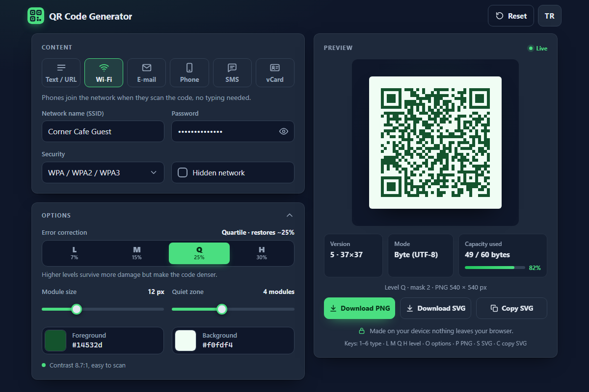

# QR Code Generator - QR codes for links, Wi-Fi, contacts and more, encoded from scratch right in your browser

[](#tests)
[](LICENSE)

**▶ Open the app: https://celaldrg.github.io/qr-generator/**



A QR code generator in plain HTML, CSS and JavaScript. The encoder is written from scratch, with no libraries: Reed-Solomon error correction, all 40 versions, the four error-correction levels and the eight masks. There is no build step and no server, and nothing you type leaves your browser.

## Features

- **Six content types:**
  - text or URL
  - Wi-Fi: WPA, WEP or an open network, optionally hidden
  - e-mail: `mailto:` with subject and message
  - phone: `tel:`
  - SMS: `SMSTO:`
  - contact card: vCard 3.0
- **Live SVG preview** that updates as you type. It is pixel-snapped to the screen's device pixel ratio, so modules stay crisp.
- **Complete encoder:**
  - versions 1-40
  - error-correction levels L, M, Q and H
  - numeric, alphanumeric and byte (UTF-8) modes
  - all eight masks with penalty scoring
  - BCH format and version information
- **Options:**
  - error-correction level, with the share of damage each level can restore
  - module size: 2-40 px
  - quiet zone: 0-10 modules
  - foreground and background colours, with a warning when the contrast falls below 3:1
- **Export:** download as PNG (up to 4096 px) or SVG, or copy the SVG markup to the clipboard.
- **Details at a glance:** version, symbol size, encoding mode, capacity used, mask and PNG size.
- **Private by design:**
  - There are no uploads, no external requests and no trackers.
  - It remembers only the content type, the options and the language, never what you type (Wi-Fi passwords, for example).
- **Two languages:** English and Turkish, switched from the header with the TR / EN button.

## How to use

1. Pick a content type: Text / URL, Wi-Fi, E-mail, Phone, SMS or vCard.
2. Fill in the fields. The preview and the version, mode and capacity details update as you type.
3. Open **Options** to choose the error-correction level, module size, quiet zone and colours.
4. Choose **Download PNG**, **Download SVG** or **Copy SVG**. **Reset** clears the fields and options.

**Keyboard (desktop).** The shortcuts work whenever the focus is not in a text field.

| Key | Action |
| --- | --- |
| `1` - `6` | Text / URL, Wi-Fi, E-mail, Phone, SMS, vCard |
| `L` `M` `Q` `H` | Error-correction level |
| `O` | Show or hide the options |
| `P` / `S` | Download PNG / SVG |
| `C` | Copy SVG |
| `←` `→` `↑` `↓`, `Home`, `End` | Move between the content types (when a type tab has the focus) |

`Tab`, `Space` and `Enter` reach and operate every control.

**Touch.** Every control is a native button, field, slider or colour picker with a tap target of at least 40 px:

- Tap a content type, then type in the fields.
- Drag the sliders.
- Tap a colour swatch to change it.

The layout is a single column on phones and two columns on wider screens.

## Run locally

There is nothing to install. Serve the folder with any static file server, for example:

```sh
npx serve .
```

Then open the printed address, such as http://localhost:3000. The app uses ES modules, which browsers load only over `http://`. Opening `index.html` directly through `file://` does not work.

## Tests

```sh
node --test
```

The tests need Node.js 22 or newer and have no dependencies. They run in about a second and cover:

- **GF(256) and Reed-Solomon:**
  - field arithmetic
  - generator polynomials
  - error-correction codewords, including the standard "HELLO WORLD" 1-Q example
- **Encoding:**
  - mode detection
  - bit streams, padding and block interleaving
  - capacity and error-correction block structure of every version and level against the ISO/IEC 18004 tables
- **Format and version information:** all 32 format words and the version words for 7-40.
- **Matrix:**
  - function patterns
  - mask formulas and the four penalty rules
  - a deterministic snapshot
  - decoding generated symbols back to their text at every version, level and mask, with a test decoder that has its own copy of the standard tables
- **Payloads:** Wi-Fi, `mailto:`, `tel:`, `SMSTO:` and vCard, with escaping.
- **App logic:**
  - colour contrast
  - SVG and canvas rendering
  - the generator state
  - storage that survives private mode
  - keyboard shortcuts
  - export sizes
  - status messages that follow a language switch
  - English/Turkish string parity, including a check that every key used in `index.html` and `src/` exists

## Project structure

```text
qr-generator/
├── index.html            page markup; every visible string is an i18n key
├── style.css             dark theme, mobile first
├── src/
│   ├── gf256.js tables.js segment.js format.js matrix.js qr.js    the QR encoder (pure)
│   ├── payload.js color.js render.js generator.js                 payloads, colours, SVG/PNG, app state (pure)
│   ├── i18n.js shortcuts.js stats.js                              strings, keys, numbers for the UI (pure)
│   ├── storage.js                                                 localStorage wrapped in try/catch
│   └── main.js fields.js tabs.js preview.js options.js exporter.js localize.js toast.js   DOM and events
├── test/                 node:test suites
└── docs/screenshot.png
```

## License

[MIT](LICENSE) © 2026 Celalettin Durgaç

QR Code is a registered trademark of DENSO WAVE INCORPORATED.

## Türkçe

Bağlantılar, Wi-Fi, kişi kartları ve daha fazlası için QR kod oluşturucu. Kodlayıcı hiçbir kütüphane kullanmadan, sıfırdan yazıldı ve tamamen tarayıcında çalışır.

**▶ Uygulamayı aç: https://celaldrg.github.io/qr-generator/**

### Özellikler

- **Altı içerik türü:**
  - metin veya bağlantı
  - Wi-Fi: WPA, WEP ya da açık ağ; istenirse gizli ağ
  - e-posta: konu ve mesajla `mailto:`
  - telefon: `tel:`
  - SMS: `SMSTO:`
  - kişi kartı: vCard 3.0
- **Canlı SVG önizleme:** yazdıkça güncellenir ve ekranın piksel oranına oturtulduğu için keskin kalır.
- **Eksiksiz kodlayıcı:**
  - 1-40 arası tüm sürümler
  - L, M, Q ve H hata düzeltme seviyeleri
  - sayısal, alfasayısal ve bayt (UTF-8) kipleri
  - ceza puanlamalı sekiz maskenin tamamı
- **Ayarlar:**
  - hata düzeltme seviyesi
  - modül boyutu: 2-40 px
  - sessiz bölge: 0-10 modül
  - ön plan ve arka plan renkleri; kontrast 3:1'in altına düşünce uyarı verir
- **Dışa aktarma:** PNG (en fazla 4096 px) ya da SVG olarak indir veya SVG'yi panoya kopyala.
- **Bilgiler:** sürüm, kip, kullanılan kapasite, maske ve PNG boyutu.
- **Gizlilik:**
  - Hiçbir veri tarayıcıdan çıkmaz.
  - Yalnızca içerik türü, ayarlar ve dil hatırlanır; yazdıkların (örneğin Wi-Fi şifresi) asla kaydedilmez.
- **İki dil:** Türkçe ve İngilizce; üst çubuktaki TR / EN düğmesiyle geçilir.

### Nasıl kullanılır

1. İçerik türünü seç.
2. Alanları doldur. Önizleme ve bilgiler yazdıkça güncellenir.
3. **Ayarlar** bölümünde seviyeyi, boyutları ve renkleri seç.
4. **PNG indir**, **SVG indir** ya da **SVG kopyala** düğmesini kullan. **Sıfırla** alanları ve ayarları temizler.

**Klavye (masaüstü).** Kısayollar, bir metin alanı odakta değilken çalışır:

- `1`-`6`: içerik türü
- `L` `M` `Q` `H`: seviye
- `O`: ayarları aç/kapat
- `P` / `S`: PNG / SVG indir
- `C`: SVG'yi kopyala
- Ok tuşları, `Home` ve `End`: türler arasında gezinme

**Dokunmatik.** Tüm denetimler en az 40 px'lik dokunma alanına sahip yerel düğme, alan, kaydırıcı ve renk seçicilerdir.

### Yerelde çalıştırma

Klasörü herhangi bir statik sunucuyla aç, örneğin `npx serve .`, sonra yazılan adrese git. ES modülleri `file://` ile değil, yalnızca `http://` üzerinden yüklenir.

### Testler

`node --test` komutunu çalıştır (Node.js 22+, bağımlılık yok). Testler şunları kapsar:

- Reed-Solomon
- tüm sürüm ve seviyelerin kapasitesi ve blok yapısı
- biçim ve sürüm bilgisi
- maskeler
- üretilen kodların, standart tablolarının kendi kopyasını kullanan bir test çözücüsüyle geri çözülmesi
- içerik biçimleri
- renk kontrastı
- çizim
- uygulama durumu
- kısayollar
- dil değişince güncellenen durum mesajları
- Türkçe/İngilizce metin eşliği

### Lisans

[MIT](LICENSE) © 2026 Celalettin Durgaç. QR Code, DENSO WAVE INCORPORATED'ın tescilli markasıdır.
